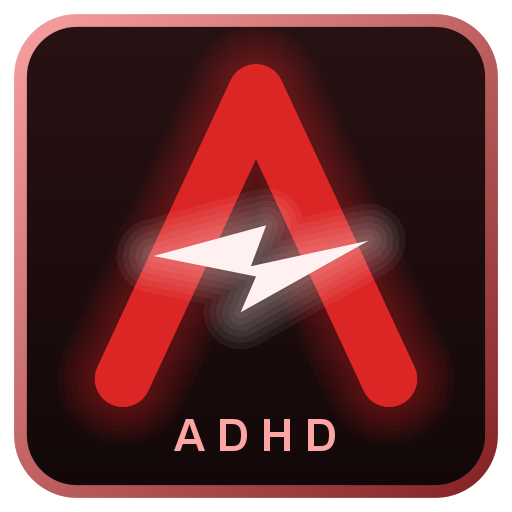

<p align="center">
  
</p>

# ADHD Client

[English](README.md) · **Deutsch**

Clientseitige Fabric-Mod für **Minecraft 1.21.11**. Statt vieler einzelner Mods bündelt der ADHD Client sie als Module, die du in einem Menü an- und ausschaltest. Alle Einstellungen machst du im Client – nur die Taste zum Öffnen des Menüs steht in den normalen Minecraft-Steuerungsoptionen.

> **Hinweis:** Dies ist ein Fan-Projekt und kein offizielles Projekt eines Servers. Viele Server erlauben solche Mods nicht. Vorher die Serverregeln prüfen; Nutzung auf eigenes Risiko.

## Installation
1. [Fabric Loader](https://fabricmc.net/use/) für 1.21.11 und die [Fabric API](https://modrinth.com/mod/fabric-api) installieren
2. `adhd-client-1.5.0.jar` in den `mods`-Ordner legen

Auf dem Server ist nichts nötig. Nicht zusammen mit den einzelnen Mods Base Finder oder Head Finder installieren – deren Funktionen stecken schon drin.

## Bedienung
**Rechte Strg** öffnet das ClickGUI (änderbar unter *Optionen → Steuerung → Tastenbelegung*). Die Module liegen in Kategorie-Fenstern (Render, Welt, Kamera, Bewegung, Sonstiges, Client), die du verschieben und per Rechtsklick auf den Titel einklappen kannst. **Linksklick** auf ein Modul schaltet es an oder aus – grüne Leiste heißt an. **Rechtsklick** öffnet seine Einstellungen. Alle Module starten ausgeschaltet.

Hat ein Modul eine eigene Taste, stellst du sie ganz oben im Menü des Moduls ein: auf den Tasten-Knopf klicken, dann die neue Taste oder eine Maustaste drücken (Esc oder Entf = keine Taste, Linksklick bricht ab). Der kleine ↺-Knopf daneben setzt die Taste auf den Standard des Moduls zurück. Modul-Tasten funktionieren nur, solange das Modul im ClickGUI eingeschaltet ist.

Unter **Design** wählst du die Farben aller Menüs (Vorlagen wie Lila, Ozean oder Rot, RGB-Regler oder Hex), die Deckkraft der Fenster und die Sprache: automatisch (wie die Spielsprache), Deutsch oder Englisch.

## Module

| Modul | Was es macht | Taste |
|---|---|---|
| **Base Finder** | Scannt geladene Chunks und markiert die besten Funde: auffällige Chunks (künstliches Licht, Spielerblöcke), unnatürliche Spawner, unnatürliche Bienennester, Amethyst-Chunks und hohen Kelp. | H Markierungen, J scannen (änderbar) |
| **Block ESP** | Markiert beliebige Blöcke, die du aus einer durchsuchbaren Liste aller Blöcke auswählst. Boxen in der Farbe des Blocks; Tracer, Füllung und Reichweite einstellbar. | – |
| **ESP** | Zeigt ausgewählte Entities (Spieler, Mobs, Items …) durch Wände: Box, leuchtender Umriss, Tracer, Namensschild mit Entfernung und Leben. Farbe nach Entfernung, Team oder fest. | – |
| **RTPQ Invsee** | Nennt der Chat deinen RTPQ-Gegner, öffnet sich automatisch `/invsee` mit "Kämpfen / Neu anstellen"-Knöpfen und Countdown; Warnung bei Elytra, Mace und vielen Crystals. Du gibst nur normalen Text ein, keine Muster. | – |
| **Free Cam** | Kamera vom Körper lösen und frei herumfliegen. Dein Körper bleibt stehen und sichtbar, Klicks sind gesperrt. Geschwindigkeit, Sprint-Faktor, sanfte Bewegung. | F6 (änderbar) |
| **Free Look** | In der dritten Person um den Spieler schauen, ohne dass er sich dreht. Abstand einstellbar (auch per Mausrad), Kamera stoppt vor Blöcken oder geht durch, halten oder umschalten, auf Wunsch auch für die normale F5-Ansicht. | Linke Alt (änderbar) |
| **Full Bright** | Alles hell wie am Tag, auch in Höhlen; auf Wunsch sieht auch der Himmel aus wie mittags (nur bei dir, die Server-Zeit bleibt gleich). Stärke einstellbar, Dunkelheits-Effekt auf Wunsch ausgeblendet. | keine nötig |
| **Blink** | Hält deine Bewegungspakete zurück: Der Server sieht dich stehen, beim Ausschalten wird alles auf einmal gesendet. Auf Wunsch eine Kopie von dir am Start, automatisch senden nach ein paar Sekunden, Abbrechen-Taste setzt dich zurück an den Start. Anticheats erkennen das oft. | keine (im Menü einstellbar) |
| **Inspect All** | Zeigt alles, was Minecraft über den angesehenen Block, die Entity oder das Item in der Hand bzw. unter der Maus weiß: Blockstate, Komponenten, NBT (hervorgehoben, einklappbar), lesbare Zusammenfassungen für Bienennester, Spawner, Schilder, Truhen u. v. m., Markierungen durch Wände, Suche, Kopieren als SNBT oder /give, JSON-Export, ein Knopf zum Löschen aller Markierungen und eine Farbpalette dafür. Ziel sperren = Overlay bleibt beim Spielen sichtbar. | I Panel, K sperren (änderbar) |
| **Packet Tools** | Eine Leiste neben jedem Container-Menü: ohne Paket schließen, nur auf dem Server schließen (Desync), Klick-Pakete aus- oder verzögern und auf einmal senden, Menü speichern und wieder öffnen, trennen und dabei senden, eigene Slot-/Knopf-Pakete bauen, Titel als JSON kopieren, Sync-ID und Revision, dazu ein Chat-Feld für Nachrichten oder Befehle, während das Menü offen bleibt. Außerdem „Alles anhalten“: keine Pakete gehen an den Server, bis du sie loslässt (oder verwirfst), mit eigener Taste, Keep-Alive-Durchlass und Live-Paket-Log. Viele Server erkennen das. | V öffnet ein gespeichertes Menü (änderbar) |
| **Lucky Casino** | Ein komplettes Casino mit Spielgeld: Slot-Maschine, Roulette, Münzwurf, Blackjack, Crash, Rubbellose, Plinko, Minenfeld, tägliches Glücksrad, Lootboxen, Missionen und Erfolge. Chips sind virtuell und lokal gespeichert; dein LuckyCasino-Spielstand wird übernommen. Auch `/casino open`. | O öffnet das Casino (änderbar) |

Alle Module arbeiten nur mit Daten, die der Client ohnehin hat. Es wird nichts zusätzlich an den Server geschickt.

Die Einstellungen liegen unter `config/adhd_client/`.

## Bauen
Benötigt Java 21.
```
./gradlew build
```
Die Jar landet in `build/libs/`. `./gradlew runClient` startet einen lokalen Testclient (standardmäßig stumm).

## Lizenz
MIT, siehe [LICENSE](LICENSE). Autor: redstone_nugget.
