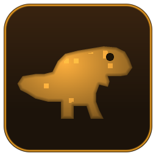

<p align="center">
  
</p>

# Nugget Client

[English](README.md) · **Deutsch**

Clientseitige Fabric-Mod für **Minecraft 1.21.11**. Statt vieler einzelner Mods bündelt der Nugget Client sie als Module, die du in einem Menü an- und ausschaltest. Alle Einstellungen machst du im Client – nur die Taste zum Öffnen des Menüs steht in den normalen Minecraft-Steuerungsoptionen.

> **Hinweis:** Dies ist ein Fan-Projekt und kein offizielles Projekt eines Servers. Viele Server erlauben solche Mods nicht. Vorher die Serverregeln prüfen; Nutzung auf eigenes Risiko.

## Installation
1. [Fabric Loader](https://fabricmc.net/use/) für 1.21.11 und die [Fabric API](https://modrinth.com/mod/fabric-api) installieren
2. `nugget-client-1.12.0.jar` in den `mods`-Ordner legen

Auf dem Server ist nichts nötig. Nicht zusammen mit den einzelnen Mods Base Finder oder Head Finder installieren – deren Funktionen stecken schon drin.

## Bedienung
**Rechte Strg** öffnet das ClickGUI (änderbar unter *Optionen → Steuerung → Tastenbelegung*). Die Module liegen in Kategorie-Fenstern (Render, Kampf, Welt, Kamera, Bewegung, Spieler, Basefinder, Jahr, Chat & Freunde, Server, Fokus, Werkzeuge, Spaß, Client), die du verschieben und per Rechtsklick auf den Titel einklappen kannst. **Linksklick** auf ein Modul schaltet es an oder aus – grüne Leiste heißt an. **Rechtsklick** öffnet seine Einstellungen. Fast alle Module starten ausgeschaltet (an sind nur Incognito, Zoom und das Client-Nutzer-Badge).

Hat ein Modul eine eigene Taste, stellst du sie ganz oben im Menü des Moduls ein: auf den Tasten-Knopf klicken, dann die neue Taste oder eine Maustaste drücken (Esc oder Entf = keine Taste, Linksklick bricht ab). Der kleine ↺-Knopf daneben setzt die Taste auf den Standard des Moduls zurück. Modul-Tasten funktionieren nur, solange das Modul im ClickGUI eingeschaltet ist.

Unter Jedes Modul-Fenster hat unten rechts einen **Zurücksetzen**-Knopf (zweimal klicken), der alle Einstellungen des Moduls auf Standard setzt.

**Design** wählst du die Farben aller Menüs (Vorlagen wie Lila, Ozean oder Rot, RGB-Regler oder Hex), die Deckkraft der Fenster und die Sprache: automatisch (wie die Spielsprache), Deutsch oder Englisch.

## Module

| Modul | Was es macht | Taste |
|---|---|---|
| **Stronghold Finder** | Triangulation wie bei Speedrunnern: Ender-Auge werfen, 100–300 Blöcke seitlich gehen, noch eins werfen – oben links stehen die Koordinaten des Strongholds (End-Portal), die Nether-Koordinaten, die Entfernung und wohin du dich drehen musst. Würfe werden automatisch erkannt. | – |
| **Base Finder** | Scannt geladene Chunks und markiert die besten Funde: auffällige Chunks (künstliches Licht, Spielerblöcke), unnatürliche Spawner, unnatürliche Bienennester, Amethyst-Chunks und hohen Kelp. | frei wählbar |
| **Block ESP** | Markiert beliebige Blöcke, die du aus einer durchsuchbaren Liste aller Blöcke auswählst. Boxen in der Farbe des Blocks; Tracer, Füllung und Reichweite einstellbar, eigene An/Aus-Taste. | deine Taste |
| **ESP** | Zeigt ausgewählte Entities (Spieler, Mobs, Items …) durch Wände: Box, leuchtender Umriss, Tracer, Namensschild mit Entfernung und Leben. Farbe nach Entfernung, Team oder fest. | – |
| **RTPQ Invsee** | Nennt der Chat deinen RTPQ-Gegner, öffnet sich automatisch `/invsee` mit "Kämpfen / Neu anstellen"-Knöpfen und Countdown; Warnung bei Elytra, Mace und vielen Crystals. Du gibst nur normalen Text ein, keine Muster. | – |
| **Free Cam** | Kamera vom Körper lösen und frei herumfliegen. Dein Körper bleibt stehen und sichtbar, andere Klicks sind gesperrt. Geschwindigkeit, Sprint-Faktor, sanfte Bewegung. Option: weiter dort abbauen, wo dein Körper hinschaut. | frei wählbar |
| **Free Look** | In der dritten Person um den Spieler schauen, ohne dass er sich dreht. Abstand einstellbar (auch per Mausrad), Kamera stoppt vor Blöcken oder geht durch, halten oder umschalten, auf Wunsch auch für die normale F5-Ansicht. | frei wählbar |
| **Full Bright** | Alles hell wie am Tag, auch in Höhlen; Option „Alles gleich hell“ nimmt alle Schatten weg; auf Wunsch sieht auch der Himmel aus wie mittags (nur bei dir, die Server-Zeit bleibt gleich). Stärke einstellbar, Dunkelheits-Effekt auf Wunsch ausgeblendet. | keine nötig |
| **Enemy Totems** | Zeigt „⚑ Totem“ hinter dem Namen von Spielern mit Totem in der Hand und wie oft ihr Totem schon geplatzt ist. | – |
| **Air Jump** | In der Luft Springen drücken = noch ein Sprung – standardmäßig unbegrenzt; Anzahl und Sprungkraft einstellbar. Auf Servern meist erkannt. | – |
| **Blink** | Hält deine Bewegungspakete zurück: Der Server sieht dich stehen, beim Ausschalten wird alles auf einmal gesendet. Auf Wunsch eine Kopie von dir am Start, automatisch senden nach ein paar Sekunden, Abbrechen-Taste setzt dich zurück an den Start. Anticheats erkennen das oft. | keine (im Menü einstellbar) |
| **Inspect All** | Zeigt alles, was Minecraft über den angesehenen Block, die Entity oder das Item in der Hand bzw. unter der Maus weiß: Blockstate, Komponenten, NBT (hervorgehoben, einklappbar), lesbare Zusammenfassungen für Bienennester, Spawner, Schilder, Truhen u. v. m., Markierungen durch Wände, Suche, Kopieren als SNBT oder /give, JSON-Export, ein Knopf zum Löschen aller Markierungen und eine Farbpalette dafür. Ziel sperren = Overlay bleibt beim Spielen sichtbar. | frei wählbar |
| **Packet Tools** | Eine Leiste neben jedem Container-Menü: ohne Paket schließen, nur auf dem Server schließen (Desync), Klick-Pakete aus- oder verzögern und auf einmal senden, Menü speichern und wieder öffnen, trennen und dabei senden, eigene Slot-/Knopf-Pakete bauen, Titel als JSON kopieren, Sync-ID und Revision, dazu ein Chat-Feld für Nachrichten oder Befehle, während das Menü offen bleibt. Außerdem „Alles anhalten“: keine Pakete gehen an den Server, bis du sie loslässt (oder verwirfst), mit eigener Taste, Keep-Alive-Durchlass und Live-Paket-Log – dazu ein großes Paket-Log-Fenster mit allen gesendeten und empfangenen Paketen, Filter, Suche, Pause, Kopieren und Zählung pro Typ. Viele Server erkennen das. | frei wählbar |
| **Client Intro** | Kurze Nugget Client-Animation im Hauptmenü beim Start; ein Klick überspringt sie. | – |
| **Calculator** | Schnell-Rechner auf Taste (N): Rechnungen mit Minecraft-Einheiten (st = 64, sh = Shulker, dk = Doppelkiste, k = 1000), Items in Shulker und Stacks aufteilen, Overworld ↔ Nether mit „Hier“-Knopf. Ergebnisse erscheinen beim Tippen. | frei wählbar |
| **Auto Reconnect** | Nach einer Trennung vom Server zählt der Trennungs-Bildschirm herunter und verbindet dich neu mit demselben Server; ein Knopf bricht ab. Wartezeit und Anzahl Versuche einstellbar. | – |
| **Macros** | Bis zu 6 Tasten, jede schickt einen Befehl (mit / am Anfang) oder eine Chat-Nachricht; mehrere mit ;; getrennt werden nacheinander geschickt. Tasten wirken nur ohne offenes Menü. | deine Tasten |
| **Auto Totem** | Fehlt das Totem in der Offhand, läuft die Hotbar-Auswahl sichtbar zum Totem, tauscht es in die Offhand (wie F) und läuft zurück zu deinem Feld. Optional auch aus dem Inventar. Eigene An/Aus-Taste. | deine Taste |
| **Anti Crystal Death** | Taucht ein End-Kristall in der Nähe auf, öffnet sich das Inventar, ein Totem kommt in Off- und Main Hand, dann schließt sich das Inventar. Reichweite einstellbar, eigene An/Aus-Taste. | deine Taste |
| **Lunge Macro** | V drücken (änderbar): nimmt den Lunge-Speer aus der Hotbar, sticht zu (Lunge-Sprung) und wechselt im selben Tick zurück aufs vorherige Item. Halten wiederholt im einstellbaren Abstand. Auf Servern oft verboten. | frei wählbar |
| **Aim Lock** | Taste drücken (G, änderbar) lockt die Entity im Fadenkreuz: Solange das Fadenkreuz irgendwo auf ihrer Hitbox ist, bewegt sich nichts; rutscht es runter, wird es zum nächsten Rand zurückgezogen. Löst sich, wenn das Ziel weiter weg ist als die eingestellten Blöcke. Tempo und „Nur Spieler“ einstellbar. Auf Servern meist verboten. | frei wählbar |
| **Ghost Items** | Legt beliebige Items nur bei dir ins Inventar (Client-seitig): aus einer Liste aller Items wählen, Anzahl einstellen, mit einem Knopf wieder entfernen. Extra-Fenster für Fake-Verzauberungen (jede Verzauberung, Stufe 1–255) auf dem Item in der Hand. Der Server weiß nichts davon – benutzen, werfen oder setzen geht nicht, und sie verschwinden, sobald der Server das Feld neu schickt. | – |
| **Storage ESP** | Kisten, Fallen-Kisten, Shulker, Fässer und Ender-Kisten durch Wände, jede Art in eigener Farbe; optional Trichter und Öfen, Füllung, Tracer und Reichweite. | – |
| **Item ESP** | Gedroppte Items leuchten durch Wände, auf Wunsch mit Name, Anzahl und Tracern. | – |
| **Nametags+** | Große Namensschilder durch Wände mit Leben, Entfernung, Rüstungs-Haltbarkeit, Item in der Hand und ob ein Totem gehalten wird. Größe einstellbar. | – |
| **Trajectories** | Zeigt, wohin Pfeile, Armbrust-Bolzen, Tridents, Enderperlen, Schneebälle, Eier, Tränke, Erfahrungsflaschen und Windkugeln fliegen und wo sie landen – bevor du schießt oder wirfst. | – |
| **Player Radar** | Kleines Fenster mit den nächsten Spielern, Entfernung und einem Pfeil in ihre Richtung (optional Koordinaten). | – |
| **New Chunks** | Markiert gerade erzeugte Chunks (fließendes Wasser/Lava beim Laden) und optional alte Chunks, in denen schon jemand war. | – |
| **Safe Walk** | Du bleibst an Kanten stehen wie beim Schleichen, ohne zu schleichen; optional nur mit Blöcken in der Hand. | – |
| **No Fall** | Kein Fallschaden: meldet dem Server beim Fallen „am Boden“. Auf Servern meist verboten. | – |
| **Auto Tool** | Nimmt beim Abbauen das schnellste Werkzeug aus der Hotbar und wechselt danach zurück. | – |
| **Auto Eat** | Isst bei wenig Hunger (oder Leben) das beste Essen aus der Hotbar und wechselt zurück. Schlechtes Essen wird gemieden. | – |
| **Auto Fish** | Holt die Angel ein, sobald ein Fisch anbeißt, und wirft nach kurzer Pause neu aus. | – |
| **Inventory Sorter** | Knopf „Sortieren“ über Inventar und Kisten (oder eine Taste): sortiert nach Item-Art und legt Stapel zusammen. | – (einstellbar) |
| **Chest Stealer** | Knöpfe „Alles nehmen“ und „Alles rein“ über Kisten und Shulkern; optional nimmt es beim Öffnen sofort alles. | – |
| **Durability** | Warnt mit Text und Ton, bevor Werkzeug oder Rüstung kaputtgeht; optional wechselt es bei 2 Haltbarkeit vom Werkzeug weg. | – |
| **Crystal Damage** | Zeigt über jedem End-Kristall, wie viel Schaden er dir und dem nächsten Gegner machen würde, und markiert den besten Platz für einen Kristall. | – |
| **Server Packs** | Fragt im Chat, ob das Pack eines Servers geladen wird (auf Wunsch pro Server gemerkt), und kann es als Zip speichern. Ein Pflicht-Pack abzulehnen trennt dich wie gewohnt. | – |
| **Anti Spawner Stealer** | Kommt ein Spieler in die Nähe, baut der Bot deine Spawner ab (zuerst mit Silk Touch, sonst trotzdem) und legt sie in die Ender-Kiste oder per Befehl weg. | – (einstellbar) |
| **PvP Training** | Nur im Einzelspieler: holt die Ausrüstung und stellt eine Übungspuppe hin, um jedes PvP-Modul selbst auszuprobieren. | – |
| **Cooldowns** | Zeigt die Abklingzeit von Perlen, Windkugeln, Schild und mehr. | – (einstellbar) |
| **Combat Inventory** | Zählt Totems, Kristalle, Perlen und Äpfel und warnt, wenn sie knapp werden. | – (einstellbar) |
| **Combat Stats** | Kills, Tode, Serie und Totem-Pops dieser Sitzung. | – (einstellbar) |
| **Enemy Armor Warn** | Meldet, wenn die Rüstung eines Gegners fast kaputt ist oder sein Totem weg ist. | – (einstellbar) |
| **Hotbar Refill** | Füllt leere Hotbar-Felder mit demselben Item aus dem Inventar. | – (einstellbar) |
| **TNT Carts** | Zeigt TNT-Carts und gezündetes TNT mit Zeit, Schaden und Radius, warnt dich setzt per Taste Schiene und Carts und kann sie mit dem Flammen-Bogen anzünden. | – (einstellbar) |
| **Auto Mace** | Taste: hochspringen; beim Fallen wird zur Mace gewechselt, zugeschlagen und zurückgewechselt. | – (einstellbar) |
| **Target HUD** | Fenster mit Lebensbalken, Rüstung %, Totem-Pops, Entfernung und Item des zuletzt geschlagenen Gegners. | – |
| **Hit Numbers** | Schaden-Zahlen steigen über Mobs und Spielern auf, wenn sie Leben verlieren. | – |
| **Pearl Predict** | Zeigt Flugbahn und Landestelle der Enderperlen anderer Spieler, mit Namen. | – |
| **Kill Effects** | Blitz, Partikel, Ton und Meldung, wenn jemand stirbt, den du geschlagen hast (nur bei dir). | – |
| **Lucky Casino** | Ein komplettes Casino mit Spielgeld: Slot-Maschine, Roulette, Münzwurf, Blackjack, Crash, Rubbellose, Plinko, Minenfeld, tägliches Glücksrad, Lootboxen, Missionen und Erfolge. Chips sind virtuell und lokal gespeichert; dein LuckyCasino-Spielstand wird übernommen. Auch `/casino open`. | frei wählbar |
| **An/Aus-Tasten** | Jedes Modul kann eine eigene An/Aus-Taste bekommen: „Modul an/aus“ oben im Fenster oder Mittelklick im ClickGUI. Im ClickGUI kannst du auch einfach lostippen, um zu suchen. | frei wählbar |
| **Kampf (1.13)** | Auto Web, Shield Breaker. | – |
| **Bewegung (1.13)** | Speed, Fly, No Slow, Elytra HUD, Move Macro (Laufen, Springen, Klicks und Umschauen aufnehmen und abspielen). | frei wählbar |
| **Render (1.13)** | Kompass-Leiste, Rüstungs-HUD, Keystrokes, Cave X-Ray, Fall Predict, Chunk Borders, Breadcrumbs, Shulker Preview. | – |
| **Welt / Spieler (1.13)** | Villager Trades, Cave Finder, Portal Calc, Auto Mine, Auto Replant, Container Search, Inventory Profiles. | frei wählbar |
| **Sell Macro** | Eine Taste schickt `/sell`, legt die gewählten Items (z. B. `bone, rotten_flesh` oder alles) ins Menü und schließt es zum Verkaufen. Hotbar und Werkzeug bleiben. | frei wählbar |
| **Music Player / Minigames** | Musik und Schallplatten aus Minecraft mit Weiter/Zufall; Snake und 2048 in einem Fenster. | – |
| **AFK Player** | Blöcke eingeben: findet sie in geladenen Chunks, läuft/gräbt hin, baut nur sichtbare Blöcke ab, sammelt Drops ein, tötet Monster, gräbt Such-Tunnel, hält bei Bases an (Liste im Fenster) und flieht mit `/spawn` oder `/home NAME` bei Spielern oder wenigen Totems. | frei wählbar |
| **Bots & Werkzeuge (1.14)** | Auto Farm, Tree Cutter, Auto Mob Farm, Auto Drop Junk, Elytra Fly, Boat Fly, Ice Speed, Order Macro, Join/Leave, Auto Reply, Treasure Map. | frei wählbar |
| **Incognito** | Versteckt deine Mods vor Servern: meldet „vanilla“ statt „fabric“, schickt keine Mod-Kanäle, Schilder und Ambosse verraten keine Mod-Texte, Server-Ressourcenpakete werden beim Trennen gelöscht und Pakete aus deinem Heimnetz blockiert. Standardmäßig an. | – |
| **Anti Ghost Items** | Holt immer wieder das echte Inventar vom Server (nach Klicks sofort), Geister-Items verschwinden; abgebaute Blöcke werden beim Server nachgeprüft. | – |
| **Crystal Optimizer** | Ein geschlagener End-Kristall verschwindet bei dir sofort – du setzt schneller den nächsten. | – |
| **Fake Elytra** | Gewählte Items im Brust-Slot (Standard: jede Brustplatte) fliegen wie eine Elytra. Auf Servern zieht es dich meist zurück – am besten im Einzelspieler. | – |
| **Kill-Feed** | Kills oben rechts wie in Shootern (Killer, Waffe, Opfer), deine in Rot. | – |
| **Client-Nutzer-Badge** | Wer „Nugget Client“ in den Chat schreibt, bekommt ein rotes ◆ in der Tab-Liste und über dem Kopf – nur diese Sitzung, nur bei dir. | – |
| **Cosmetics** | Eine Propeller-Mütze auf dem Kopf. Nur bei dir sichtbar. | – |
| **Nugget Sky** | Eigener Himmel aus Texturepacks. | – |
| **Nugget Style** | Eigene Texturepacks: jede Textur aus jedem Pack wählen und mischen. | – |
| **Fast Left Click** | Gehaltene linke Maustaste wiederholt sich wie eine Tastatur-Taste. | – |
| **Fast Right Click** | Gehaltene rechte Maustaste platziert so schnell wie eine Tastatur-Taste. | – |
| **Replay-Buffer** | Merkt sich die letzten 30 Sekunden und spielt sie als Geister nach (Pause, Spulen, Tempo). Mit Free Cam frei herumfliegen. | frei wählbar |
| **Basefinder (Kategorie)** | Newer Chunks (neu / besucht / alte Version / Spuren, pro Server gespeichert), Base Score, Unnatural Blocks, Plant Age, Mining Radar, Player History, Highway Finder, Elytra Scan Bot und das Basefinder Log mit allen Funden (Wegpunkt per Klick). | – |
| **Jahr (Kategorie)** | Schnee-Effekt, Weihnachts-Design, Weihnachtsmützen, Lichterkette, Advent-Countdown, Winter-Titelbildschirm, Geschenke-ESP – auf Wunsch nur vom 1. bis 26. Dezember. | – |

Fast alle Module arbeiten nur mit Daten, die der Client ohnehin hat. Ausnahme: Anti Ghost Items schickt kleine Anfragen an den Server.

Die Einstellungen liegen unter `config/nugget_client/`.

## Bauen
Benötigt Java 21.
```
./gradlew build
```
Die Jar landet in `build/libs/`. `./gradlew runClient` startet einen lokalen Testclient (standardmäßig stumm).

## Lizenz
Alle Rechte vorbehalten – siehe [LICENSE](LICENSE). Autor: NuggetRex. Du darfst Nugget Client selbst benutzen, aber nicht verkaufen, weitergeben oder neu hochladen, keine veränderten Versionen veröffentlichen und ihn nicht unter einem anderen Namen zeigen.

## Credits
