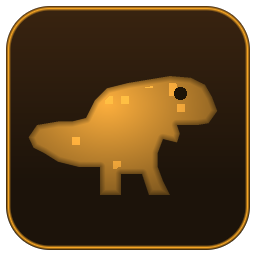

<p align="center">
  
</p>

# Nugget Client

**English** · [Deutsch](README.de.md)

Client-side Fabric mod for **Minecraft 1.21.11**. Instead of installing many separate mods, Nugget Client bundles them as modules that you switch on or off in one menu. Every setting is made inside the client – only the key that opens the menu lives in the normal Minecraft controls.

> **Note:** This is a fan project and is not affiliated with any server. Many servers don't allow mods like this. Check the server rules first; use at your own risk.

## Installation
1. Install the [Fabric Loader](https://fabricmc.net/use/) for 1.21.11 and the [Fabric API](https://modrinth.com/mod/fabric-api)
2. Put `nugget-client-1.12.0.jar` into your `mods` folder

Nothing is needed on the server. Don't install it together with the standalone Base Finder or Head Finder mods – that functionality is already included.

## Usage
Press **Right Ctrl** to open the click GUI (changeable under *Options → Controls → Key Binds*). Modules are grouped into category windows (Render, Combat, World, Camera, Movement, Player, Basefinder, Season, Chat & Friends, Server, Focus, Tools, Fun, Client) that you can drag around and collapse with a right click on the title. **Left click** a module to turn it on or off – a green bar means on. **Right click** opens its settings. Almost all modules start switched off (only Incognito, Zoom and the Client User Badge are on).

If a module has its own key, you set it at the very top of that module's menu: click the key button, then press the new key or a mouse button (Esc or Delete means no key, left click cancels). The small ↺ button next to it puts the key back to the module's default. Module keys only work while the module is switched on in the ClickGUI.

Every module window has a **Reset** button at the bottom right (click twice) that puts all its settings back to default.

**Design** lets you pick the colors of all menus (presets like Purple, Ocean or Red, RGB sliders or hex), the window opacity and the language: automatic (follows the game language), German or English.

## Modules

| Module | What it does | Key |
|---|---|---|
| **Stronghold Finder** | Triangulation like speedrunners: throw an eye of ender, walk 100–300 blocks sideways, throw another one – top left shows the stronghold (end portal) coordinates, the Nether coordinates, the distance and which way to turn. Eyes are detected automatically. | – |
| **Base Finder** | Scans loaded chunks and marks the best finds: suspicious chunks (artificial light, player blocks), unnatural spawners, unnatural bee nests, amethyst chunks and tall kelp. | free to choose |
| **Block ESP** | Highlights any blocks you pick from a searchable list of every block in the game. Boxes take the block's color; optional tracers, fill and range. | – |
| **ESP** | Shows selected entities (players, mobs, items …) through walls: box, glow outline, tracers, name tags with distance and health. Color by distance, team or a fixed color. | – |
| **RTPQ Invsee** | When the chat names your RTPQ opponent, `/invsee` opens automatically with "fight / requeue" buttons and a countdown, and warns about elytra, mace and many crystals. You only enter plain text, no patterns. | – |
| **Free Cam** | Detach the camera and fly around freely. Your body stays in place and visible; other clicks are blocked. Speed, sprint factor, smooth movement. Option: keep mining the block your body looks at. | free to choose |
| **Free Look** | Look around your player in third person without turning them. Distance adjustable (also with the scroll wheel), camera stops at blocks or goes through them, hold or toggle, optionally also for the normal F5 view. | free to choose |
| **Full Bright** | Everything as bright as broad daylight, even in caves; option "Everything flat bright" removes all shadows; optionally the sky looks like noon too (only for you, the server time stays the same). Adjustable strength, optionally ignores the Darkness effect. | none needed |
| **Enemy Totems** | Shows "⚑ Totem" after the name of players holding a totem, and how often their totem popped. | – |
| **Air Jump** | Press jump in mid-air to jump again – unlimited by default; number of air jumps and strength adjustable. Usually detected on servers. | – |
| **Blink** | Holds back your movement packets: the server sees you standing still, and when you turn it off everything is sent at once. Optional copy of you at the start, auto send after a few seconds, cancel key that puts you back at the start. Anticheats often detect it. | none (set in the menu) |
| **Inspect All** | Shows everything Minecraft knows about the block or entity you look at, or the item in your hand or under the mouse: block state, components, NBT (highlighted, collapsible), readable summaries for bee nests, spawners, signs, chests and more, markers through walls, search, copy as SNBT or /give, JSON export, a button to clear all markers and a color palette for them. Lock a target to keep an overlay while you play. | free to choose |
| **Packet Tools** | A bar next to every container menu: close without packet, close only on the server (desync), turn click packets off or delay them and send them all at once, save a menu and reopen it, disconnect while sending, build your own slot/button click packets, copy the title as JSON, sync ID and revision, and a chat field to write messages or commands while the menu stays open. Plus "Hold all": no packets go to the server until you release them (or discard them), with its own key, keep-alive passthrough and a live packet log – plus a large packet log window showing every sent and received packet with filter, search, pause, copy and a count per type. Many servers detect this. | free to choose |
| **Client Intro** | Short Nugget Client animation on the title screen at start; a click skips it. | – |
| **Calculator** | Quick calculator on a key (N): math with Minecraft units (st = 64, sh = shulker, dk = double chest, k = 1000), items split into shulkers and stacks, overworld ↔ nether coordinates with a "here" button. Results appear as you type. | free to choose |
| **Auto Reconnect** | After a disconnect from a server, the disconnect screen counts down and reconnects you to the same server; a button cancels it. Wait time and number of attempts adjustable. | – |
| **Macros** | Up to 6 keys, each sends a command (starting with /) or a chat message; several separated with ;; are sent one after another. Keys only work with no menu open. | your keys |
| **Auto Totem** | If there is no totem in your offhand, the hotbar selection visibly scrolls to a totem, swaps it into the offhand (like F) and scrolls back to your slot. Optional: also from the inventory. Own on/off key. | your key |
| **Anti Crystal Death** | When an end crystal appears nearby, your inventory opens, a totem goes into your offhand and main hand, and the inventory closes again. Range adjustable, own on/off key. | your key |
| **Lunge Macro** | Press V (changeable): takes the lunge spear from your hotbar, jabs (lunge dash) and switches back to your item in the same tick. Hold to repeat with an adjustable interval. Often not allowed on servers. | free to choose |
| **Aim Lock** | Press the key (G, changeable) to lock onto the entity in your crosshair: as long as your crosshair is anywhere on its hitbox nothing moves; when it slips off, it is pulled back to the nearest edge. Releases when the target is farther than the set number of blocks. Speed and players-only option. Usually not allowed on servers. | free to choose |
| **Ghost Items** | Puts any item into your inventory only on your side (client-side): pick it from a list of every item, choose the count, remove them again with one button. Extra window for fake enchantments (any enchantment, level 1–255) on the item in your hand. The server knows nothing – you cannot use, drop or place them, and they vanish as soon as the server updates the slot. | – |
| **Storage ESP** | Chests, trapped chests, shulkers, barrels and ender chests through walls, each type in its own color; optional hoppers and furnaces, fill, tracers and range. | – |
| **Item ESP** | Dropped items glow through walls, optionally with name and count and tracers. | – |
| **Nametags+** | Big name tags through walls with health, distance, armor durability, the item in hand and whether a totem is held. Size adjustable. | – |
| **Trajectories** | Shows where arrows, crossbow bolts, tridents, ender pearls, snowballs, eggs, potions, XP bottles and wind charges will fly and land, before you shoot or throw. | – |
| **Player Radar** | Small window with the nearest players, their distance and an arrow pointing to them (optional coordinates). | – |
| **New Chunks** | Marks chunks that were just generated (flowing water/lava when they load) and optionally old chunks where someone has been before. | – |
| **Safe Walk** | You stop at edges like when sneaking, without sneaking; optionally only while holding blocks. | – |
| **No Fall** | No fall damage: tells the server you are on the ground while falling. Usually not allowed on servers. | – |
| **Auto Tool** | Takes the fastest tool from your hotbar when you start mining and switches back afterwards. | – |
| **Auto Eat** | Eats the best food from your hotbar when your hunger (or health) is low and switches back. Skips bad food. | – |
| **Auto Fish** | Reels in as soon as a fish bites and casts again after a short pause. | – |
| **Inventory Sorter** | "Sort" button above your inventory and chests (or a key): sorts by item type and merges stacks. | – (settable) |
| **Chest Stealer** | "Take all" and "Put all" buttons above chests and shulkers; optionally takes everything as soon as a chest opens. | – |
| **Durability** | Warns with text and sound before a tool or armor piece breaks; optionally switches away from a tool at 2 durability. | – |
| **Crystal Damage** | Shows above every end crystal how much damage it would do to you and the nearest enemy, and marks the best spot for a crystal. | – |
| **Server Packs** | Asks in chat whether to load a server's resource pack (or remember it per server) and can save the pack as a zip. Declining a required pack disconnects you as usual. | – |
| **Anti Spawner Stealer** | When a player comes near, the bot mines your spawners (Silk Touch first, otherwise anyway) and stores them in the ender chest or via a command. | – (settable) |
| **PvP Training** | Singleplayer only: gets the gear and places a training dummy so you can try every PvP module yourself. | – |
| **Cooldowns** | Shows the cooldown of pearls, wind charges, shields and more. | – (settable) |
| **Combat Inventory** | Counts totems, crystals, pearls and apples and warns when they run low. | – (settable) |
| **Combat Stats** | Kills, deaths, streak and totem pops of this session. | – (settable) |
| **Enemy Armor Warn** | Tells you when an enemy's armor is almost broken or their totem is gone. | – (settable) |
| **Hotbar Refill** | Fills empty hotbar slots with the same item from your inventory. | – (settable) |
| **TNT Carts** | Shows TNT carts and primed TNT with time, damage and blast radius, warns you, places a rail with carts by key and can ignite them with a Flame bow. | – (settable) |
| **Auto Mace** | Key: jump up; while falling it switches to the mace, hits the target and switches back. | – (settable) |
| **Target HUD** | Window with health bar, armor %, totem pops, distance and held item of the enemy you hit last. | – |
| **Hit Numbers** | Damage numbers rise above mobs and players when they lose health. | – |
| **Pearl Predict** | Shows the flight path and landing spot of ender pearls other players throw, with their name. | – |
| **Kill Effects** | Lightning, particles, sound and a message when someone you hit dies (only for you). | – |
| **Lucky Casino** | A full casino with play money: slot machine, roulette, coin flip, blackjack, crash, scratch cards, Plinko, mines, daily wheel, loot boxes, missions and achievements. Chips are virtual and stored locally; your LuckyCasino progress carries over. Also `/casino open`. | free to choose |
| **Toggle keys** | Every module can get its own on/off key: "Module toggle" at the top of its window, or middle-click it in the ClickGUI. In the ClickGUI you can also just type to search. | your choice |
| **Combat (1.13)** | Auto Web, Shield Breaker. | – |
| **Movement (1.13)** | Speed, Fly, No Slow, Elytra HUD, Move Macro (record and replay walking, jumping, clicks and looking). | Move Macro: changeable |
| **Render (1.13)** | Compass Bar, Armor HUD, Keystrokes, Cave X-Ray, Fall Predict, Chunk Borders, Breadcrumbs, Shulker Preview. | – |
| **World / Player (1.13)** | Villager Trades, Cave Finder, Portal Calc, Auto Mine, Auto Replant, Container Search, Inventory Profiles. | Profiles: changeable |
| **Sell Macro** | One key sends `/sell`, puts the chosen items (e.g. `bone, rotten_flesh`, or everything) into the menu and closes it to sell. Hotbar and tools stay. | changeable |
| **Music Player / Minigames** | Minecraft's own music and discs with next/shuffle; Snake and 2048 in a window. | – |
| **AFK Player** | Enter blocks, it finds them in loaded chunks, walks/digs there, mines only visible blocks, collects drops, kills monsters, digs search tunnels, stops at bases (list in its window) and escapes with `/spawn` or `/home NAME` on players or few totems. | your choice |
| **Bots & tools (1.14)** | Auto Farm, Tree Cutter, Auto Mob Farm, Auto Drop Junk, Elytra Fly, Boat Fly, Ice Speed, Order Macro, Join/Leave, Auto Reply, Treasure Map. | Order Macro: changeable |
| **Incognito** | Hides your mods from servers: reports “vanilla” instead of “fabric”, sends no mod channels, signs and anvils reveal no mod texts, server resource packs are deleted on disconnect and packs from your home network are blocked. On by default. | – |
| **Anti Ghost Items** | Keeps fetching the real inventory from the server (right after clicks), ghost items disappear; mined blocks are re-checked with the server. | – |
| **Crystal Optimizer** | A hit end crystal disappears instantly for you – you place the next one faster. | – |
| **Fake Elytra** | Chosen items in the chest slot (default: any chestplate) fly like an elytra. On servers you usually get pulled back – best in singleplayer. | – |
| **Kill-Feed** | Kills top right like in shooters (killer, weapon, victim), yours in red. | – |
| **Client User Badge** | Players who write "Nugget Client" in chat get a red ◆ in the tab list and above the head – this session only, only for you. | – |
| **Cosmetics** | A propeller cap on your head. Only visible to you. | – |
| **Nugget Sky** | Custom skies from resource packs. | – |
| **Nugget Style** | Your own resource packs: pick every texture from any pack and mix them. | – |
| **Fast Left Click** | A held left mouse button repeats like a keyboard key. | – |
| **Fast Right Click** | A held right mouse button places as fast as a keyboard key. | – |
| **Replay Buffer** | Remembers the last 30 seconds and replays them as ghosts (pause, seek, speed). Use Free Cam to fly around. | free to choose |
| **Basefinder (category)** | Newer Chunks (new / visited / old version / trails, saved per server), Base Score, Unnatural Blocks, Plant Age, Mining Radar, Player History, Highway Finder, Elytra Scan Bot and the Basefinder Log with all finds (waypoint per click). | – |
| **Season (category)** | Snow effect, Christmas theme, Santa hats, fairy lights, Advent countdown, winter title screen, gift ESP – optionally only December 1–26. | – |

Almost all modules only use data your client already has. Exception: Anti Ghost Items sends small requests to the server.

Settings are stored in `config/nugget_client/`.

## Building
Requires Java 21.
```
./gradlew build
```
The jar ends up in `build/libs/`. `./gradlew runClient` starts a local test client (muted by default).

## License
All rights reserved – see [LICENSE](LICENSE). Author: NuggetRex. You may use Nugget Client yourself, but you may not sell it, share or re-upload it, publish modified versions or present it under another name.

## Credits
